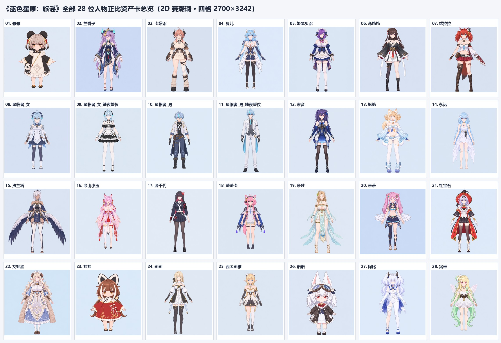
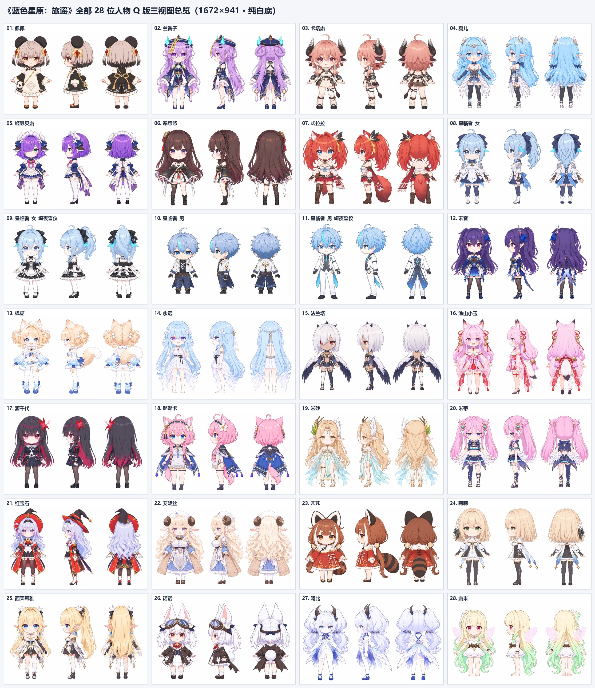
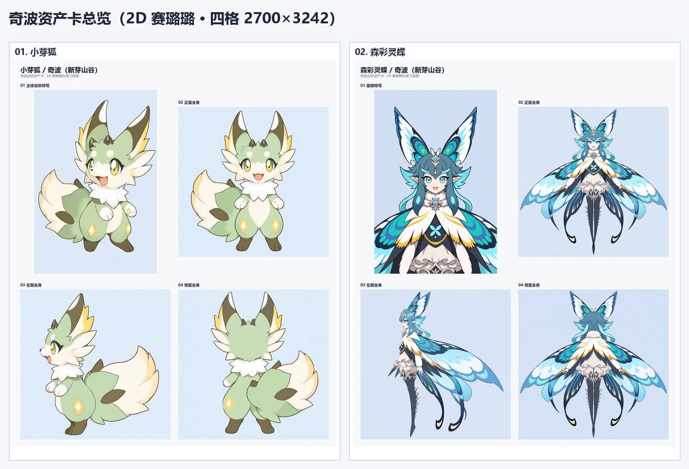

# 《蓝色星原：旅谣》角色与奇波 2D 资产卡合集（正比 + Q 版）

> 本仓库收录 **28 位人物角色**（含男女星临者默认装扮与绮夜誓仪、露米、永远等）与 **2 只奇波** 的 **纯 2D 赛璐璐四格正比资产卡**、**四视角无损单格** 及 **28 张 16:9 纯白底 Q 版三视图**，适用于二次元动画分镜、视频制作、角色一致性参考与二创辅助。

## 目录结构

```text
.
├── README.md                          # 说明文档与全角色索引
├── previews/                          # 总览墙预览图
├── characters/
│   ├── standard_cards/                # 28 张人物正比四格总卡（2700×3242 PNG）
│   ├── chibi_turnarounds/             # 28 张人物 Q 版三视图（1672×941 纯白底 PNG）
│   └── modules/<角色名>/              # 28×4 张四视角单格（01_face / 02_front / 03_left / 04_back）
├── kibos/
│   ├── standard_cards/                # 2 张奇波正比四格总卡（小芽狐、森彩灵蝶）
│   └── modules/<奇波名>/              # 2×4 张奇波四视角单格
├── references/
│   └── 露米与女性星临者比例参照图.png    # 露米 × 女性星临者 1:6.5 视频比例参照图
└── docs/
    ├── SPEC.md                        # 资产规格与比例说明
    └── MANIFEST.md                    # 资产文件清单
```

## 总览预览

### 1. 全部 28 位人物正比资产卡总览


### 2. 全部 28 位人物 Q 版三视图总览


### 3. 奇波资产卡与视频比例参照



## 全部 28 位人物资产索引

| # | 角色 | 正比四格总卡 (`2700×3242`) | Q 版三视图 (`1672×941`) | 四视角单格 |
| :--- | :--- | :--- | :--- | :--- |
| 01 | **佩佩** | [正比总卡](characters/standard_cards/%E4%BD%A9%E4%BD%A9_asset_card.png) | [Q 版三视图](characters/chibi_turnarounds/%E4%BD%A9%E4%BD%A9_Q%E7%89%88%E4%B8%89%E8%A7%86%E5%9B%BE.png) | [01](characters/modules/%E4%BD%A9%E4%BD%A9/01_face.png) · [02](characters/modules/%E4%BD%A9%E4%BD%A9/02_front.png) · [03](characters/modules/%E4%BD%A9%E4%BD%A9/03_left.png) · [04](characters/modules/%E4%BD%A9%E4%BD%A9/04_back.png) |
| 02 | **兰香子** | [正比总卡](characters/standard_cards/%E5%85%B0%E9%A6%99%E5%AD%90_asset_card.png) | [Q 版三视图](characters/chibi_turnarounds/%E5%85%B0%E9%A6%99%E5%AD%90_Q%E7%89%88%E4%B8%89%E8%A7%86%E5%9B%BE.png) | [01](characters/modules/%E5%85%B0%E9%A6%99%E5%AD%90/01_face.png) · [02](characters/modules/%E5%85%B0%E9%A6%99%E5%AD%90/02_front.png) · [03](characters/modules/%E5%85%B0%E9%A6%99%E5%AD%90/03_left.png) · [04](characters/modules/%E5%85%B0%E9%A6%99%E5%AD%90/04_back.png) |
| 03 | **卡塔露** | [正比总卡](characters/standard_cards/%E5%8D%A1%E5%A1%94%E9%9C%B2_asset_card.png) | [Q 版三视图](characters/chibi_turnarounds/%E5%8D%A1%E5%A1%94%E9%9C%B2_Q%E7%89%88%E4%B8%89%E8%A7%86%E5%9B%BE.png) | [01](characters/modules/%E5%8D%A1%E5%A1%94%E9%9C%B2/01_face.png) · [02](characters/modules/%E5%8D%A1%E5%A1%94%E9%9C%B2/02_front.png) · [03](characters/modules/%E5%8D%A1%E5%A1%94%E9%9C%B2/03_left.png) · [04](characters/modules/%E5%8D%A1%E5%A1%94%E9%9C%B2/04_back.png) |
| 04 | **夏儿** | [正比总卡](characters/standard_cards/%E5%A4%8F%E5%84%BF_asset_card.png) | [Q 版三视图](characters/chibi_turnarounds/%E5%A4%8F%E5%84%BF_Q%E7%89%88%E4%B8%89%E8%A7%86%E5%9B%BE.png) | [01](characters/modules/%E5%A4%8F%E5%84%BF/01_face.png) · [02](characters/modules/%E5%A4%8F%E5%84%BF/02_front.png) · [03](characters/modules/%E5%A4%8F%E5%84%BF/03_left.png) · [04](characters/modules/%E5%A4%8F%E5%84%BF/04_back.png) |
| 05 | **姬瑟贝露** | [正比总卡](characters/standard_cards/%E5%A7%AC%E7%91%9F%E8%B4%9D%E9%9C%B2_asset_card.png) | [Q 版三视图](characters/chibi_turnarounds/%E5%A7%AC%E7%91%9F%E8%B4%9D%E9%9C%B2_Q%E7%89%88%E4%B8%89%E8%A7%86%E5%9B%BE.png) | [01](characters/modules/%E5%A7%AC%E7%91%9F%E8%B4%9D%E9%9C%B2/01_face.png) · [02](characters/modules/%E5%A7%AC%E7%91%9F%E8%B4%9D%E9%9C%B2/02_front.png) · [03](characters/modules/%E5%A7%AC%E7%91%9F%E8%B4%9D%E9%9C%B2/03_left.png) · [04](characters/modules/%E5%A7%AC%E7%91%9F%E8%B4%9D%E9%9C%B2/04_back.png) |
| 06 | **寒悠悠** | [正比总卡](characters/standard_cards/%E5%AF%92%E6%82%A0%E6%82%A0_asset_card.png) | [Q 版三视图](characters/chibi_turnarounds/%E5%AF%92%E6%82%A0%E6%82%A0_Q%E7%89%88%E4%B8%89%E8%A7%86%E5%9B%BE.png) | [01](characters/modules/%E5%AF%92%E6%82%A0%E6%82%A0/01_face.png) · [02](characters/modules/%E5%AF%92%E6%82%A0%E6%82%A0/02_front.png) · [03](characters/modules/%E5%AF%92%E6%82%A0%E6%82%A0/03_left.png) · [04](characters/modules/%E5%AF%92%E6%82%A0%E6%82%A0/04_back.png) |
| 07 | **忒拉拉** | [正比总卡](characters/standard_cards/%E5%BF%92%E6%8B%89%E6%8B%89_asset_card.png) | [Q 版三视图](characters/chibi_turnarounds/%E5%BF%92%E6%8B%89%E6%8B%89_Q%E7%89%88%E4%B8%89%E8%A7%86%E5%9B%BE.png) | [01](characters/modules/%E5%BF%92%E6%8B%89%E6%8B%89/01_face.png) · [02](characters/modules/%E5%BF%92%E6%8B%89%E6%8B%89/02_front.png) · [03](characters/modules/%E5%BF%92%E6%8B%89%E6%8B%89/03_left.png) · [04](characters/modules/%E5%BF%92%E6%8B%89%E6%8B%89/04_back.png) |
| 08 | **星临者_女** | [正比总卡](characters/standard_cards/%E6%98%9F%E4%B8%B4%E8%80%85_%E5%A5%B3_asset_card.png) | [Q 版三视图](characters/chibi_turnarounds/%E6%98%9F%E4%B8%B4%E8%80%85_%E5%A5%B3_Q%E7%89%88%E4%B8%89%E8%A7%86%E5%9B%BE.png) | [01](characters/modules/%E6%98%9F%E4%B8%B4%E8%80%85_%E5%A5%B3/01_face.png) · [02](characters/modules/%E6%98%9F%E4%B8%B4%E8%80%85_%E5%A5%B3/02_front.png) · [03](characters/modules/%E6%98%9F%E4%B8%B4%E8%80%85_%E5%A5%B3/03_left.png) · [04](characters/modules/%E6%98%9F%E4%B8%B4%E8%80%85_%E5%A5%B3/04_back.png) |
| 09 | **星临者_女_绮夜誓仪** | [正比总卡](characters/standard_cards/%E6%98%9F%E4%B8%B4%E8%80%85_%E5%A5%B3_%E7%BB%AE%E5%A4%9C%E8%AA%93%E4%BB%AA_asset_card.png) | [Q 版三视图](characters/chibi_turnarounds/%E6%98%9F%E4%B8%B4%E8%80%85_%E5%A5%B3_%E7%BB%AE%E5%A4%9C%E8%AA%93%E4%BB%AA_Q%E7%89%88%E4%B8%89%E8%A7%86%E5%9B%BE.png) | [01](characters/modules/%E6%98%9F%E4%B8%B4%E8%80%85_%E5%A5%B3_%E7%BB%AE%E5%A4%9C%E8%AA%93%E4%BB%AA/01_face.png) · [02](characters/modules/%E6%98%9F%E4%B8%B4%E8%80%85_%E5%A5%B3_%E7%BB%AE%E5%A4%9C%E8%AA%93%E4%BB%AA/02_front.png) · [03](characters/modules/%E6%98%9F%E4%B8%B4%E8%80%85_%E5%A5%B3_%E7%BB%AE%E5%A4%9C%E8%AA%93%E4%BB%AA/03_left.png) · [04](characters/modules/%E6%98%9F%E4%B8%B4%E8%80%85_%E5%A5%B3_%E7%BB%AE%E5%A4%9C%E8%AA%93%E4%BB%AA/04_back.png) |
| 10 | **星临者_男** | [正比总卡](characters/standard_cards/%E6%98%9F%E4%B8%B4%E8%80%85_%E7%94%B7_asset_card.png) | [Q 版三视图](characters/chibi_turnarounds/%E6%98%9F%E4%B8%B4%E8%80%85_%E7%94%B7_Q%E7%89%88%E4%B8%89%E8%A7%86%E5%9B%BE.png) | [01](characters/modules/%E6%98%9F%E4%B8%B4%E8%80%85_%E7%94%B7/01_face.png) · [02](characters/modules/%E6%98%9F%E4%B8%B4%E8%80%85_%E7%94%B7/02_front.png) · [03](characters/modules/%E6%98%9F%E4%B8%B4%E8%80%85_%E7%94%B7/03_left.png) · [04](characters/modules/%E6%98%9F%E4%B8%B4%E8%80%85_%E7%94%B7/04_back.png) |
| 11 | **星临者_男_绮夜誓仪** | [正比总卡](characters/standard_cards/%E6%98%9F%E4%B8%B4%E8%80%85_%E7%94%B7_%E7%BB%AE%E5%A4%9C%E8%AA%93%E4%BB%AA_asset_card.png) | [Q 版三视图](characters/chibi_turnarounds/%E6%98%9F%E4%B8%B4%E8%80%85_%E7%94%B7_%E7%BB%AE%E5%A4%9C%E8%AA%93%E4%BB%AA_Q%E7%89%88%E4%B8%89%E8%A7%86%E5%9B%BE.png) | [01](characters/modules/%E6%98%9F%E4%B8%B4%E8%80%85_%E7%94%B7_%E7%BB%AE%E5%A4%9C%E8%AA%93%E4%BB%AA/01_face.png) · [02](characters/modules/%E6%98%9F%E4%B8%B4%E8%80%85_%E7%94%B7_%E7%BB%AE%E5%A4%9C%E8%AA%93%E4%BB%AA/02_front.png) · [03](characters/modules/%E6%98%9F%E4%B8%B4%E8%80%85_%E7%94%B7_%E7%BB%AE%E5%A4%9C%E8%AA%93%E4%BB%AA/03_left.png) · [04](characters/modules/%E6%98%9F%E4%B8%B4%E8%80%85_%E7%94%B7_%E7%BB%AE%E5%A4%9C%E8%AA%93%E4%BB%AA/04_back.png) |
| 12 | **末音** | [正比总卡](characters/standard_cards/%E6%9C%AB%E9%9F%B3_asset_card.png) | [Q 版三视图](characters/chibi_turnarounds/%E6%9C%AB%E9%9F%B3_Q%E7%89%88%E4%B8%89%E8%A7%86%E5%9B%BE.png) | [01](characters/modules/%E6%9C%AB%E9%9F%B3/01_face.png) · [02](characters/modules/%E6%9C%AB%E9%9F%B3/02_front.png) · [03](characters/modules/%E6%9C%AB%E9%9F%B3/03_left.png) · [04](characters/modules/%E6%9C%AB%E9%9F%B3/04_back.png) |
| 13 | **枫糖** | [正比总卡](characters/standard_cards/%E6%9E%AB%E7%B3%96_asset_card.png) | [Q 版三视图](characters/chibi_turnarounds/%E6%9E%AB%E7%B3%96_Q%E7%89%88%E4%B8%89%E8%A7%86%E5%9B%BE.png) | [01](characters/modules/%E6%9E%AB%E7%B3%96/01_face.png) · [02](characters/modules/%E6%9E%AB%E7%B3%96/02_front.png) · [03](characters/modules/%E6%9E%AB%E7%B3%96/03_left.png) · [04](characters/modules/%E6%9E%AB%E7%B3%96/04_back.png) |
| 14 | **永远** | [正比总卡](characters/standard_cards/%E6%B0%B8%E8%BF%9C_asset_card.png) | [Q 版三视图](characters/chibi_turnarounds/%E6%B0%B8%E8%BF%9C_Q%E7%89%88%E4%B8%89%E8%A7%86%E5%9B%BE.png) | [01](characters/modules/%E6%B0%B8%E8%BF%9C/01_face.png) · [02](characters/modules/%E6%B0%B8%E8%BF%9C/02_front.png) · [03](characters/modules/%E6%B0%B8%E8%BF%9C/03_left.png) · [04](characters/modules/%E6%B0%B8%E8%BF%9C/04_back.png) |
| 15 | **法兰塔** | [正比总卡](characters/standard_cards/%E6%B3%95%E5%85%B0%E5%A1%94_asset_card.png) | [Q 版三视图](characters/chibi_turnarounds/%E6%B3%95%E5%85%B0%E5%A1%94_Q%E7%89%88%E4%B8%89%E8%A7%86%E5%9B%BE.png) | [01](characters/modules/%E6%B3%95%E5%85%B0%E5%A1%94/01_face.png) · [02](characters/modules/%E6%B3%95%E5%85%B0%E5%A1%94/02_front.png) · [03](characters/modules/%E6%B3%95%E5%85%B0%E5%A1%94/03_left.png) · [04](characters/modules/%E6%B3%95%E5%85%B0%E5%A1%94/04_back.png) |
| 16 | **涂山小玉** | [正比总卡](characters/standard_cards/%E6%B6%82%E5%B1%B1%E5%B0%8F%E7%8E%89_asset_card.png) | [Q 版三视图](characters/chibi_turnarounds/%E6%B6%82%E5%B1%B1%E5%B0%8F%E7%8E%89_Q%E7%89%88%E4%B8%89%E8%A7%86%E5%9B%BE.png) | [01](characters/modules/%E6%B6%82%E5%B1%B1%E5%B0%8F%E7%8E%89/01_face.png) · [02](characters/modules/%E6%B6%82%E5%B1%B1%E5%B0%8F%E7%8E%89/02_front.png) · [03](characters/modules/%E6%B6%82%E5%B1%B1%E5%B0%8F%E7%8E%89/03_left.png) · [04](characters/modules/%E6%B6%82%E5%B1%B1%E5%B0%8F%E7%8E%89/04_back.png) |
| 17 | **源千代** | [正比总卡](characters/standard_cards/%E6%BA%90%E5%8D%83%E4%BB%A3_asset_card.png) | [Q 版三视图](characters/chibi_turnarounds/%E6%BA%90%E5%8D%83%E4%BB%A3_Q%E7%89%88%E4%B8%89%E8%A7%86%E5%9B%BE.png) | [01](characters/modules/%E6%BA%90%E5%8D%83%E4%BB%A3/01_face.png) · [02](characters/modules/%E6%BA%90%E5%8D%83%E4%BB%A3/02_front.png) · [03](characters/modules/%E6%BA%90%E5%8D%83%E4%BB%A3/03_left.png) · [04](characters/modules/%E6%BA%90%E5%8D%83%E4%BB%A3/04_back.png) |
| 18 | **璐璐卡** | [正比总卡](characters/standard_cards/%E7%92%90%E7%92%90%E5%8D%A1_asset_card.png) | [Q 版三视图](characters/chibi_turnarounds/%E7%92%90%E7%92%90%E5%8D%A1_Q%E7%89%88%E4%B8%89%E8%A7%86%E5%9B%BE.png) | [01](characters/modules/%E7%92%90%E7%92%90%E5%8D%A1/01_face.png) · [02](characters/modules/%E7%92%90%E7%92%90%E5%8D%A1/02_front.png) · [03](characters/modules/%E7%92%90%E7%92%90%E5%8D%A1/03_left.png) · [04](characters/modules/%E7%92%90%E7%92%90%E5%8D%A1/04_back.png) |
| 19 | **米砂** | [正比总卡](characters/standard_cards/%E7%B1%B3%E7%A0%82_asset_card.png) | [Q 版三视图](characters/chibi_turnarounds/%E7%B1%B3%E7%A0%82_Q%E7%89%88%E4%B8%89%E8%A7%86%E5%9B%BE.png) | [01](characters/modules/%E7%B1%B3%E7%A0%82/01_face.png) · [02](characters/modules/%E7%B1%B3%E7%A0%82/02_front.png) · [03](characters/modules/%E7%B1%B3%E7%A0%82/03_left.png) · [04](characters/modules/%E7%B1%B3%E7%A0%82/04_back.png) |
| 20 | **米蒂** | [正比总卡](characters/standard_cards/%E7%B1%B3%E8%92%82_asset_card.png) | [Q 版三视图](characters/chibi_turnarounds/%E7%B1%B3%E8%92%82_Q%E7%89%88%E4%B8%89%E8%A7%86%E5%9B%BE.png) | [01](characters/modules/%E7%B1%B3%E8%92%82/01_face.png) · [02](characters/modules/%E7%B1%B3%E8%92%82/02_front.png) · [03](characters/modules/%E7%B1%B3%E8%92%82/03_left.png) · [04](characters/modules/%E7%B1%B3%E8%92%82/04_back.png) |
| 21 | **红宝石** | [正比总卡](characters/standard_cards/%E7%BA%A2%E5%AE%9D%E7%9F%B3_asset_card.png) | [Q 版三视图](characters/chibi_turnarounds/%E7%BA%A2%E5%AE%9D%E7%9F%B3_Q%E7%89%88%E4%B8%89%E8%A7%86%E5%9B%BE.png) | [01](characters/modules/%E7%BA%A2%E5%AE%9D%E7%9F%B3/01_face.png) · [02](characters/modules/%E7%BA%A2%E5%AE%9D%E7%9F%B3/02_front.png) · [03](characters/modules/%E7%BA%A2%E5%AE%9D%E7%9F%B3/03_left.png) · [04](characters/modules/%E7%BA%A2%E5%AE%9D%E7%9F%B3/04_back.png) |
| 22 | **艾妮丝** | [正比总卡](characters/standard_cards/%E8%89%BE%E5%A6%AE%E4%B8%9D_asset_card.png) | [Q 版三视图](characters/chibi_turnarounds/%E8%89%BE%E5%A6%AE%E4%B8%9D_Q%E7%89%88%E4%B8%89%E8%A7%86%E5%9B%BE.png) | [01](characters/modules/%E8%89%BE%E5%A6%AE%E4%B8%9D/01_face.png) · [02](characters/modules/%E8%89%BE%E5%A6%AE%E4%B8%9D/02_front.png) · [03](characters/modules/%E8%89%BE%E5%A6%AE%E4%B8%9D/03_left.png) · [04](characters/modules/%E8%89%BE%E5%A6%AE%E4%B8%9D/04_back.png) |
| 23 | **芃芃** | [正比总卡](characters/standard_cards/%E8%8A%83%E8%8A%83_asset_card.png) | [Q 版三视图](characters/chibi_turnarounds/%E8%8A%83%E8%8A%83_Q%E7%89%88%E4%B8%89%E8%A7%86%E5%9B%BE.png) | [01](characters/modules/%E8%8A%83%E8%8A%83/01_face.png) · [02](characters/modules/%E8%8A%83%E8%8A%83/02_front.png) · [03](characters/modules/%E8%8A%83%E8%8A%83/03_left.png) · [04](characters/modules/%E8%8A%83%E8%8A%83/04_back.png) |
| 24 | **莉莉** | [正比总卡](characters/standard_cards/%E8%8E%89%E8%8E%89_asset_card.png) | [Q 版三视图](characters/chibi_turnarounds/%E8%8E%89%E8%8E%89_Q%E7%89%88%E4%B8%89%E8%A7%86%E5%9B%BE.png) | [01](characters/modules/%E8%8E%89%E8%8E%89/01_face.png) · [02](characters/modules/%E8%8E%89%E8%8E%89/02_front.png) · [03](characters/modules/%E8%8E%89%E8%8E%89/03_left.png) · [04](characters/modules/%E8%8E%89%E8%8E%89/04_back.png) |
| 25 | **西芙莉雅** | [正比总卡](characters/standard_cards/%E8%A5%BF%E8%8A%99%E8%8E%89%E9%9B%85_asset_card.png) | [Q 版三视图](characters/chibi_turnarounds/%E8%A5%BF%E8%8A%99%E8%8E%89%E9%9B%85_Q%E7%89%88%E4%B8%89%E8%A7%86%E5%9B%BE.png) | [01](characters/modules/%E8%A5%BF%E8%8A%99%E8%8E%89%E9%9B%85/01_face.png) · [02](characters/modules/%E8%A5%BF%E8%8A%99%E8%8E%89%E9%9B%85/02_front.png) · [03](characters/modules/%E8%A5%BF%E8%8A%99%E8%8E%89%E9%9B%85/03_left.png) · [04](characters/modules/%E8%A5%BF%E8%8A%99%E8%8E%89%E9%9B%85/04_back.png) |
| 26 | **诺诺** | [正比总卡](characters/standard_cards/%E8%AF%BA%E8%AF%BA_asset_card.png) | [Q 版三视图](characters/chibi_turnarounds/%E8%AF%BA%E8%AF%BA_Q%E7%89%88%E4%B8%89%E8%A7%86%E5%9B%BE.png) | [01](characters/modules/%E8%AF%BA%E8%AF%BA/01_face.png) · [02](characters/modules/%E8%AF%BA%E8%AF%BA/02_front.png) · [03](characters/modules/%E8%AF%BA%E8%AF%BA/03_left.png) · [04](characters/modules/%E8%AF%BA%E8%AF%BA/04_back.png) |
| 27 | **阿比** | [正比总卡](characters/standard_cards/%E9%98%BF%E6%AF%94_asset_card.png) | [Q 版三视图](characters/chibi_turnarounds/%E9%98%BF%E6%AF%94_Q%E7%89%88%E4%B8%89%E8%A7%86%E5%9B%BE.png) | [01](characters/modules/%E9%98%BF%E6%AF%94/01_face.png) · [02](characters/modules/%E9%98%BF%E6%AF%94/02_front.png) · [03](characters/modules/%E9%98%BF%E6%AF%94/03_left.png) · [04](characters/modules/%E9%98%BF%E6%AF%94/04_back.png) |
| 28 | **露米** | [正比总卡](characters/standard_cards/%E9%9C%B2%E7%B1%B3_asset_card.png) | [Q 版三视图](characters/chibi_turnarounds/%E9%9C%B2%E7%B1%B3_Q%E7%89%88%E4%B8%89%E8%A7%86%E5%9B%BE.png) | [01](characters/modules/%E9%9C%B2%E7%B1%B3/01_face.png) · [02](characters/modules/%E9%9C%B2%E7%B1%B3/02_front.png) · [03](characters/modules/%E9%9C%B2%E7%B1%B3/03_left.png) · [04](characters/modules/%E9%9C%B2%E7%B1%B3/04_back.png) |

## 奇波资产索引

| # | 奇波 | 正比四格总卡 (`2700×3242`) | 四视角单格 |
| :--- | :--- | :--- | :--- |
| 01 | **小芽狐** | [正比总卡](kibos/standard_cards/%E5%B0%8F%E8%8A%BD%E7%8B%90_asset_card.png) | [01](kibos/modules/%E5%B0%8F%E8%8A%BD%E7%8B%90/01_face.png) · [02](kibos/modules/%E5%B0%8F%E8%8A%BD%E7%8B%90/02_front.png) · [03](kibos/modules/%E5%B0%8F%E8%8A%BD%E7%8B%90/03_left.png) · [04](kibos/modules/%E5%B0%8F%E8%8A%BD%E7%8B%90/04_back.png) |
| 02 | **森彩灵蝶** | [正比总卡](kibos/standard_cards/%E6%A3%AE%E5%BD%A9%E7%81%B5%E8%9D%B6_asset_card.png) | [01](kibos/modules/%E6%A3%AE%E5%BD%A9%E7%81%B5%E8%9D%B6/01_face.png) · [02](kibos/modules/%E6%A3%AE%E5%BD%A9%E7%81%B5%E8%9D%B6/02_front.png) · [03](kibos/modules/%E6%A3%AE%E5%BD%A9%E7%81%B5%E8%9D%B6/03_left.png) · [04](kibos/modules/%E6%A3%AE%E5%BD%A9%E7%81%B5%E8%9D%B6/04_back.png) |

## 规格与清单

- 完整画风、尺寸与视频比例说明见 [docs/SPEC.md](docs/SPEC.md)。
- 完整资产文件清单见 [docs/MANIFEST.md](docs/MANIFEST.md)。

## 免责与版权声明

- 本仓库内全部图片均为基于《蓝色星原：旅谣》公开官方情报整理的**非官方同人/二创参考资产卡**，角色原设与相关知识产权归 **蛮啾网络（Manjuu Co., Ltd.）** 所有。
- 仅供个人学习、交流与非商业用途二次创作参考，禁止任何商业用途。
